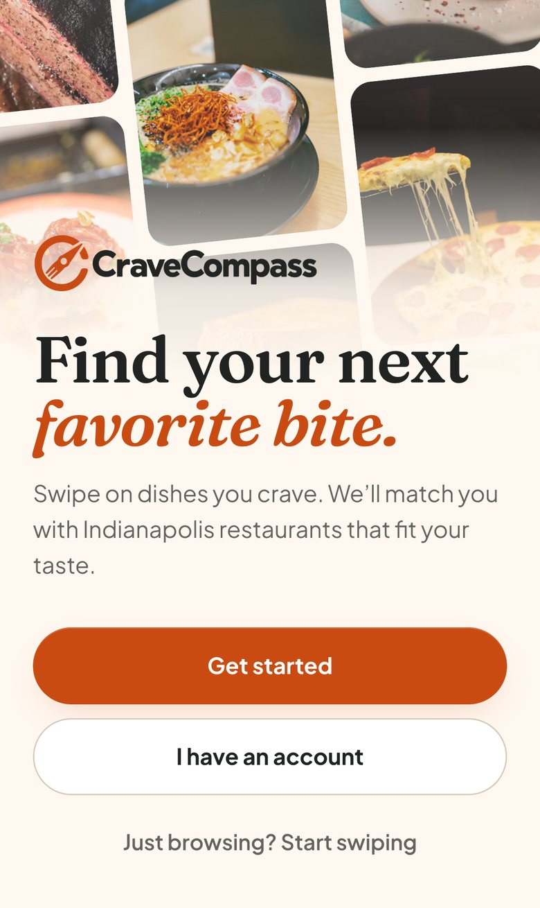
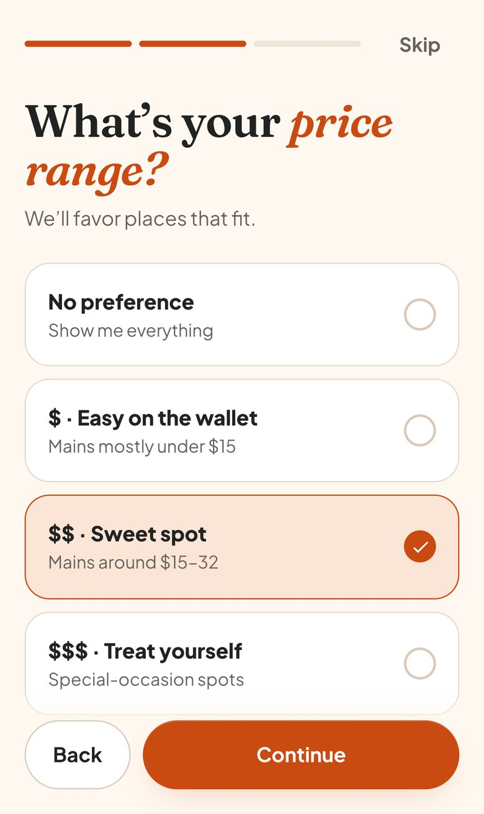
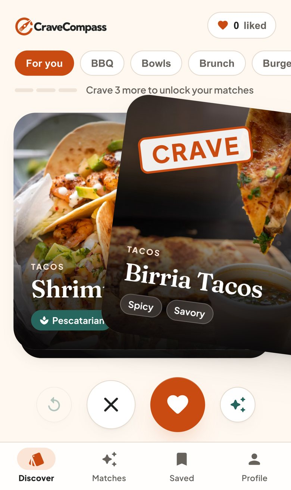
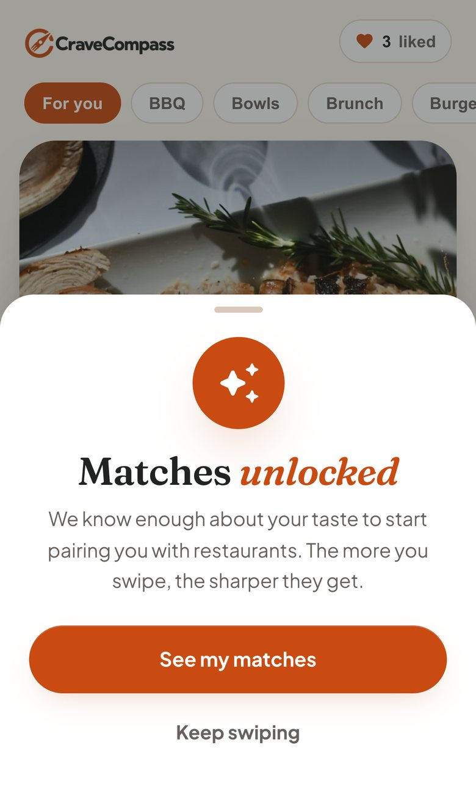
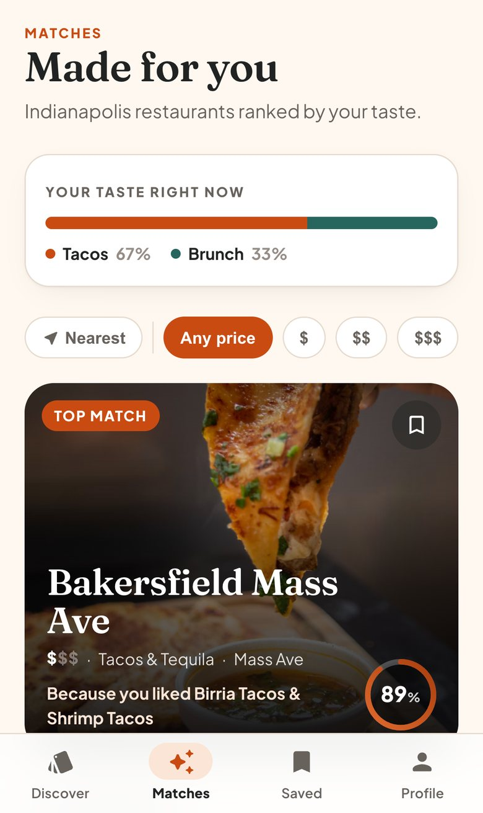
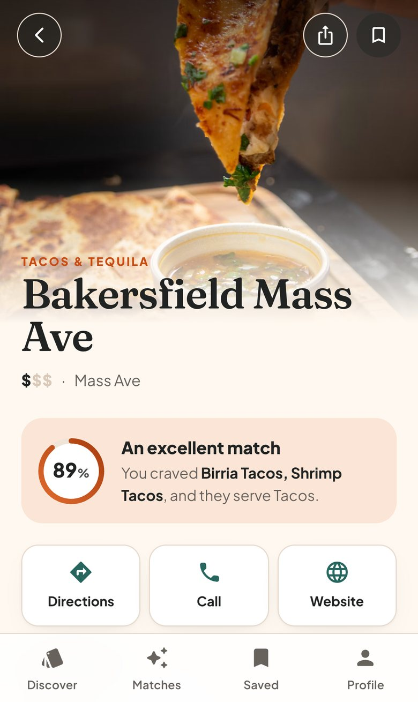
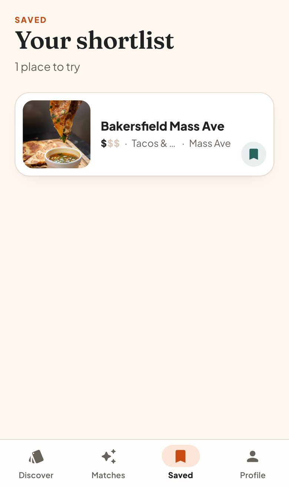
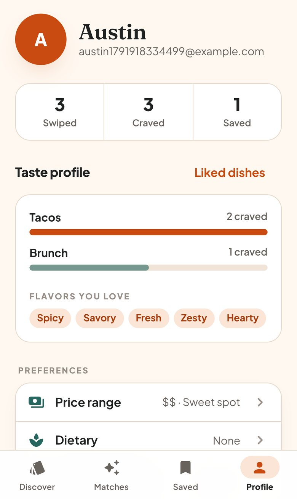
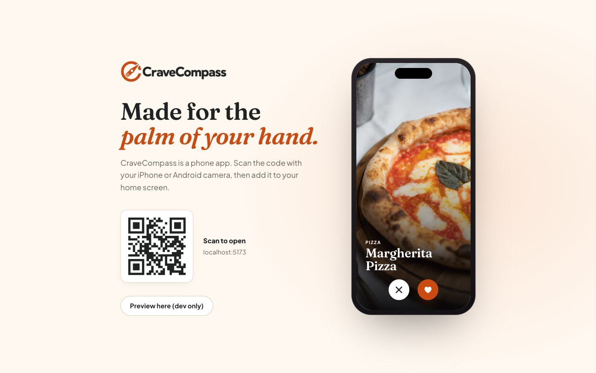

# CraveCompass

Swipe on dishes you crave and get matched with Indianapolis restaurants that fit your taste.

CraveCompass is a **mobile-only installable web app (PWA)**. On iPhone, open it in Safari and choose
**Share → Add to Home Screen**. On Android, Chrome offers **Install app**. Desktop browsers get a
"scan to open on your phone" screen.

## Screens

<table>
  <tr>
    <td align="center"><br /><sub><b>Welcome</b></sub></td>
    <td align="center"><br /><sub><b>Onboarding</b></sub></td>
    <td align="center"><br /><sub><b>Swipe deck</b></sub></td>
    <td align="center"><br /><sub><b>Matches unlocked</b></sub></td>
  </tr>
  <tr>
    <td align="center"><br /><sub><b>Ranked matches</b></sub></td>
    <td align="center"><br /><sub><b>Restaurant</b></sub></td>
    <td align="center"><br /><sub><b>Saved</b></sub></td>
    <td align="center"><br /><sub><b>Taste profile</b></sub></td>
  </tr>
</table>

On a computer, CraveCompass hands visitors off to their phone:



## Features

- **Swipe deck**: drag or tap to crave or pass. Your favorite cuisines lead the deck, dietary
  needs filter it, and you can undo.
- **Ranked matches**: restaurants are scored against your taste profile, each with a reason
  ("Because you liked Birria Tacos"). Filter by price or sort by distance.
- **Restaurant pages**: directions (Apple or Google Maps), call, website, share, save.
- **Saved list, taste profile and preferences**: price range, dietary needs, favorite cuisines.
- **Accounts**: email and password (bcrypt + JWT). Swipes you make as a guest carry over when you
  sign up. You can delete your account.
- **Installable and offline-friendly**: a service worker caches the app shell and food photos.

## Stack

| Layer    | Tools                                                     |
| -------- | --------------------------------------------------------- |
| Frontend | React 19, Vite, MUI 7, Framer Motion, vite-plugin-pwa     |
| Backend  | Node, Express 5, Prisma 6, PostgreSQL                     |
| Hosting  | Railway (one service serves the API and the built app)    |

## Local development

```bash
npm install
createdb cravecompass_dev   # or any Postgres database
echo 'DATABASE_URL="postgresql://USER@localhost:5432/cravecompass_dev"' > .env
echo 'JWT_SECRET="any-long-random-string"' >> .env
npm run db:migrate && npm run db:seed

npm run dev:api   # API on :3001
npm run dev       # app on :5173 (also on your LAN IP, so you can open it on your phone)
```

On a desktop browser in dev, click **Preview here (dev only)** to see the app in a phone frame.

## Data

The dish and restaurant catalog lives in `backend/data/*.json`. `npm run db:seed` syncs it
idempotently and runs on every deploy. Restaurants missing from the file are deactivated, never
deleted. Restaurant details were checked against each restaurant's own website. Price levels come
from menu prices; if a price couldn't be verified, it is left blank and the app hides it.

## Deploy (Railway)

`npm start` runs migrations, syncs the catalog and starts the server. Set `DATABASE_URL`, and ideally
`JWT_SECRET`. Without it, a secret is derived from `DATABASE_URL`.
